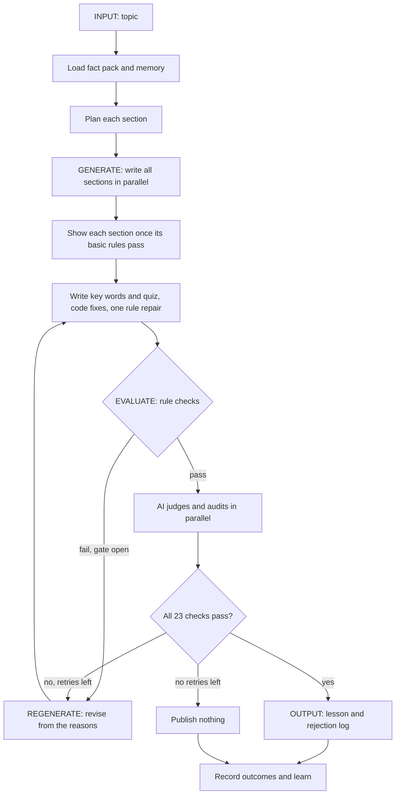

# LessonProof

An agentic system that writes a beginner lesson, judges it against a hard pass/fail rubric, and regenerates it until it clears the bar. A lesson that never clears the bar is not published.

Built for the GenAI Engineer (Content Systems) take-home. The submission topic is **Introduction to RAG**. The audience is a 12th-grade graduate from India with limited English vocabulary and no technical background.

## Quick start

You need **Python 3.11 or newer** and a free [Gemini API key](https://aistudio.google.com/apikey). Node.js is only needed if `frontend/dist` is missing or you change the frontend.

Run these commands from the project folder, the one that contains this README.

**Windows (PowerShell)**

```powershell
python -m venv .venv
.venv\Scripts\python -m pip install -e "./backend[google,dev]"
Copy-Item .env.example .env
notepad .env
.venv\Scripts\lessonproof serve
```

**macOS or Linux**

```bash
python3 -m venv .venv
.venv/bin/python -m pip install -e "./backend[google,dev]"
cp .env.example .env
nano .env
.venv/bin/lessonproof serve
```

In `.env`, set `GOOGLE_API_KEY=your-key`. Then open http://127.0.0.1:8000.

The approved RAG lesson opens without using the API. Creating a lesson or running a quality-check test needs a key with quota left.

### Building the frontend

The zip includes a built frontend. A fresh Git clone does not, so build it with Node.js 22.12 or newer:

```bash
cd frontend
npm ci
npm run build
```

For frontend development, keep the server running and start `npm run dev` in `frontend/`. Vite forwards `/api` to the backend.

### Common problems

| Problem | Fix |
| --- | --- |
| `frontend/dist/index.html was not found` | Build the frontend as shown above. |
| `lessonproof` is not recognized | Use the full path shown above, or activate `.venv` first. |
| Port 8000 is in use | Run `lessonproof serve --port 8001`. |
| "Add a working API key to create lessons" | Set `GOOGLE_API_KEY` in `.env` and restart the server. |
| "Today's free AI limit is used up" | Wait for the time shown, or use a paid key. The free tier allows about 20 requests a day on most models, and one run can use about 40. |
| Windows blocks `Activate.ps1` | Skip activation and use the full path shown above. |

## Final output

- Lesson: [outputs/latest/lesson.md](outputs/latest/lesson.md)
- Rejection log: [outputs/latest/rejection_log.md](outputs/latest/rejection_log.md)

## How it works



The workflow is a [LangGraph](backend/src/lessonproof/graph.py) state machine with at most 2 retries, so each run always terminates. The web app also starts over once from a fresh plan if a run fails.

| Part | Location | Role |
| --- | --- | --- |
| Rubric | [rubric/rubric.yaml](backend/src/lessonproof/rubric/rubric.yaml) | 23 versioned pass/fail checks |
| Fact pack | [knowledge/rag.yaml](backend/src/lessonproof/knowledge/rag.yaml) | Source of truth for writing and fact-checking |
| Authoring agents | [agents/authoring.py](backend/src/lessonproof/agents/authoring.py) | Researcher, planner, section writers, reviser |
| Rule checks | [evaluation/deterministic.py](backend/src/lessonproof/evaluation/deterministic.py) | Free, repeatable measurements |
| AI judges | [evaluation/judges.py](backend/src/lessonproof/evaluation/judges.py) | Independent judges and evidence audits |
| Model layer | [llm.py](backend/src/lessonproof/llm.py) | Hedged failover and token accounting |
| Memory | [memory.py](backend/src/lessonproof/memory.py) | SQLite store that persists across runs |
| Self-evolution | [agents/evolver.py](backend/src/lessonproof/agents/evolver.py) | Turns repeated failures and feedback into improvements |
| Evaluation suite | [benchmarks/](backend/src/lessonproof/benchmarks/) | Planted errors, stability, benchmark |
| API | [api/](backend/src/lessonproof/api/) | FastAPI endpoints and live event stream |
| Frontend | [frontend/](frontend/) | React, TypeScript, and Vite app |

## The rubric

Each check is a hard pass or fail, and one failure rejects the lesson.

| Dimension | Checks | Method |
| --- | --- | --- |
| Accurate and grounded | ACC-1 no contradictions; ACC-2 claims supported; ACC-3 no absolute promises; ACC-4 no invented statistics | Sentence audit and rules |
| Beginner-friendly language | LANG-1 reading grade at most 8; LANG-2 sentence length; LANG-3 rare words; LANG-4 paragraph length; BEG-1 no assumed knowledge; BEG-2 familiar Indian context | Rules and judge |
| Teaches by example | EX-1 worked example shows the topic's real steps; EX-2 useful comparisons in each core section | Judge |
| Clear, no unexplained jargon | JAR-1 terms listed; JAR-2 terms explained at first use; JAR-3 short word list; JAR-4 abbreviations spelled out | Rules and judge |
| Covers the key points | COV-1 each key point taught; COV-2 required sections; COV-3 self-check quiz | Audit and rules |
| Coherent teaching flow | FLOW-1 order and length; FLOW-2 no idea used before it is taught; FLOW-3 quiz is fair and correct; FLOW-4 recap adds nothing new | Rules and judge |

## Design decisions

**Code decides, models report.** The fact checker receives numbered sentences and must rule on each one. Code computes the verdict, re-asks about anything skipped, and fails anything still unruled.

**Fail closed.** Judge quotes must appear in the lesson. A pass that cannot be verified counts as a fail, and a model outage stops the run with nothing published.

**Mechanical problems are solved by code.** Long paragraphs, missing glossary terms, and an over-long word list are fixed at no token cost, and each fix is logged.

**Parallel writers share a plan.** The planner gives each section its own heading, scope, facts, terms, and word target, so writers working at the same time do not repeat each other.

**A slow model cannot hold up a run.** If a model has not answered after 15 seconds, the next one starts as well, and the first valid answer wins.

**Failed drafts never reach the learner.** The API does not send a failed draft to the browser. The rejection log still shows what failed, why, and what changed.

**The bar is protected from the learning loop.** Writer guidelines apply immediately, because the evaluator still judges their results. Notes that change how judges behave stay candidates until calibration shows no harm. Pass criteria change only through the versioned rubric.

### Trade-offs

- **Quality over tokens.** Judges use medium thinking, which costs more, because low thinking missed serious planted errors.
- **Speed over tokens.** Racing a second model reduces waiting, but can pay for both calls.
- **Separate judges over one call.** More calls in exchange for more independent verdicts.
- **Comparisons and sample content are exempt from "unsupported".** This avoids false rejections, and it means such sentences fail only if they contradict the facts.
- **Curated facts over any topic.** Any topic works, but a topic without a curated pack gets model-written facts, and the UI warns about that.

## Evaluation results

All numbers come from live API runs on 6 and 7 November 2026, using Gemini's free tier. **The main model, `gemini-3.5-flash`, was out of daily quota, so these runs used the lite fallback models.**

| Measurement | Result |
| --- | --- |
| Final lesson under the final rubric | **23 of 23** checks |
| Planted errors caught on that lesson | **16 of 17** ([calibration.json](outputs/evaluations/calibration.json)) |
| False rejections of that lesson | **0** |
| Final lesson reading level | Grade 6.8, 687 words, 0.9% uncommon words |
| Repeat-judging stability | **Not measured on the final code**, because the quota ran out |
| Multi-run benchmark | **Not measured on the final code**, because the quota ran out |

The final lesson came from run `20261106-190509-84070e`, on an earlier version of the pipeline. It was chosen over newer passing lessons because reading them showed weaker worked examples, then re-judged under the final rubric.

### Waiting time, measured in a real browser

| Topic and version | First part visible | Total | Result |
| --- | --- | --- | --- |
| Before parallel writing: "What is curve?" | Nothing until the end | 214s | Rejected |
| Parallel: "What is curve?" | 37s | 194s, 2 tries | Not published |
| Parallel: RAG | 16s | 148s, 2 tries | Not published |
| Parallel: RAG | 15s | 103s, 2 tries | Passed |
| Parallel: RAG | 10s | 128s, 2 tries | Not published |
| Final code: RAG | 15s | 210s, 2 tries | Passed |

An approved lesson is reused instantly. One try used about 85,000 to 122,000 tokens, which is higher than the earlier single-writer design.

### What testing changed

| Finding | Response |
| --- | --- |
| Low-thinking judges caught only 12 of 15 planted errors | Medium thinking, new rule ACC-4, and tighter FLOW criteria |
| Every judge passed a lesson that never spelled out "LLM" | New rule JAR-4 |
| The fact checker skipped sentences when asked to list claims | Rulings on numbered sentences |
| One hung model cost 89 seconds | Racing models, and skipping models out of daily quota |
| The key-word checks kept wasting retries | Fixed in code with a verified glossary |
| A loosened EX-1 passed a story that never showed RAG's steps | EX-1 now requires the topic's own steps |

## Known limitations

- **Pass rate is low on the lite models.** In the 5 parallel browser runs above, 3 ended with no lesson, even with the automatic second try. The main model has not been measured on its own. A later run on a topic with no fact sheet mixed the main and lite models, and it was rejected after 3 tries on ACC-2, BEG-1, and JAR-2.
- **Only tested on Windows.** A clean install was tested on Windows 11 with Python 3.11. The code has no Windows-specific paths, but macOS and Linux have not been run.
- **Total wait is still long** when a run needs a second try, up to about 3.5 minutes, even though the first part appears in 10 to 16 seconds on curated topics.
- **Token use is high**, at about 85,000 to 122,000 per try. The free tier cannot sustain this, so reliable use needs a paid key.
- **Live parts are previews.** A section can appear and later be replaced or withdrawn if the lesson fails.
- **Judges miss things.** A planted false claim about RAG's origin was missed in the final test, and a newer lesson passed EX-1 without showing its found text and prompt. A human should review lessons before real use.
- **Exemptions reduce strictness.** A false statement written as a comparison passes unless it contradicts the fact sheet.
- **Learning is not proven.** Guidelines are created and applied, but no measured improvement has been shown, and their quality varies.
- **The final lesson has weak spots.** One quiz answer goes slightly beyond the lesson body, and it predates the voice improvements in the final code.
- **Fact sources are partly verified.** The cited arXiv abstracts were checked, but individual facts were not traced through the full papers, and basic definitions are general knowledge.
- **One limit was loosened.** The key-word limit (JAR-3) went from 10 to 12.
- **The server has no login.** It binds to `127.0.0.1`, so do not expose it publicly as it stands.

## Commands

| Command | What it does |
| --- | --- |
| `lessonproof serve` | Start the API and web app. |
| `lessonproof run ["topic"]` | Run the pipeline in the terminal. Exits 0 if shipped, 1 if rejected, 2 if the model service failed. |
| `lessonproof evaluate` | Run the full rubric on an existing lesson. |
| `lessonproof list-errors` | List the deliberate errors that can be planted. |
| `lessonproof inject-error <id>` | Plant one error in the passing lesson and run the full rubric. |
| `lessonproof calibrate [--sharpen]` | Measure planted-error catches. `--sharpen` proposes stricter judge notes and keeps them only if they do no harm. |
| `lessonproof stability --repeats N` | Judge one unchanged lesson N times and report changed verdicts. |
| `lessonproof benchmark --runs N` | Run the pipeline N times with shared memory. |
| `lessonproof feedback <run_id> "text"` | Leave human feedback for the next run to learn from. |
| `lessonproof memory` | Show past runs, guidelines, and judge notes. |

## API

| Method and path | Purpose |
| --- | --- |
| `GET /api/config` | Models, rubric, and planted errors |
| `POST /api/runs` | Start a run with `{"topic": "...", "regenerate": false}` |
| `POST /api/inject-error` | Evaluate a corrupted lesson with `{"defect_id": "..."}` |
| `GET /api/jobs/{id}/events` | Live progress as server-sent events |
| `GET /api/runs`, `GET /api/runs/{id}` | Run history and details |
| `POST /api/runs/{id}/feedback` | Human feedback with `{"text": "..."}` |
| `GET /api/memory` | Learned guidelines and judge notes |

## Configuration

Settings are read from `.env`. See [.env.example](.env.example) for the common ones and [config.py](backend/src/lessonproof/config.py) for all of them.

Any LangChain provider works. Install its extra and set the models, for example `pip install -e "./backend[anthropic]"` with `LESSON_WRITER_MODEL=anthropic:<model-id>` and `LESSON_JUDGE_MODEL=anthropic:<model-id>`. Also set `LESSON_FALLBACK_MODELS`, because the defaults are Gemini models. Thinking levels are only sent to Gemini models.

## Project structure

```text
.
├── .env.example            Settings template; copy to .env
├── README.md
├── backend/
│   ├── pyproject.toml      Python package and dependencies
│   └── src/lessonproof/
│       ├── agents/         Authoring agents and self-evolution
│       ├── api/            FastAPI endpoints and background jobs
│       ├── benchmarks/     Planted errors and measurement suite
│       ├── evaluation/     Rule checks, judges, and evaluator
│       ├── knowledge/      Curated fact packs
│       ├── prompts/        System prompts as Markdown
│       ├── rubric/         Versioned rubric
│       ├── cli.py          Command-line interface
│       ├── config.py       Settings
│       ├── graph.py        LangGraph workflow
│       ├── llm.py          Model calls, failover, token accounting
│       ├── memory.py       Persistent SQLite memory
│       ├── reporting.py    Lesson, rejection log, and trace output
│       ├── schemas.py      Typed data contracts
│       └── text.py         Text measurement helpers
├── frontend/               React, TypeScript, and Vite app (builds to frontend/dist)
│   └── src/
│       ├── components/     Home page, step tracker, side panels, lesson, rejection log
│       ├── api.ts          API calls and event stream
│       └── runState.ts     Live run state
├── data/                   Memory database, created on first start and not committed
└── outputs/
    ├── latest/             Final lesson and rejection log
    ├── evaluations/        Calibration results
    └── runs/               Full trace of the final run
```
